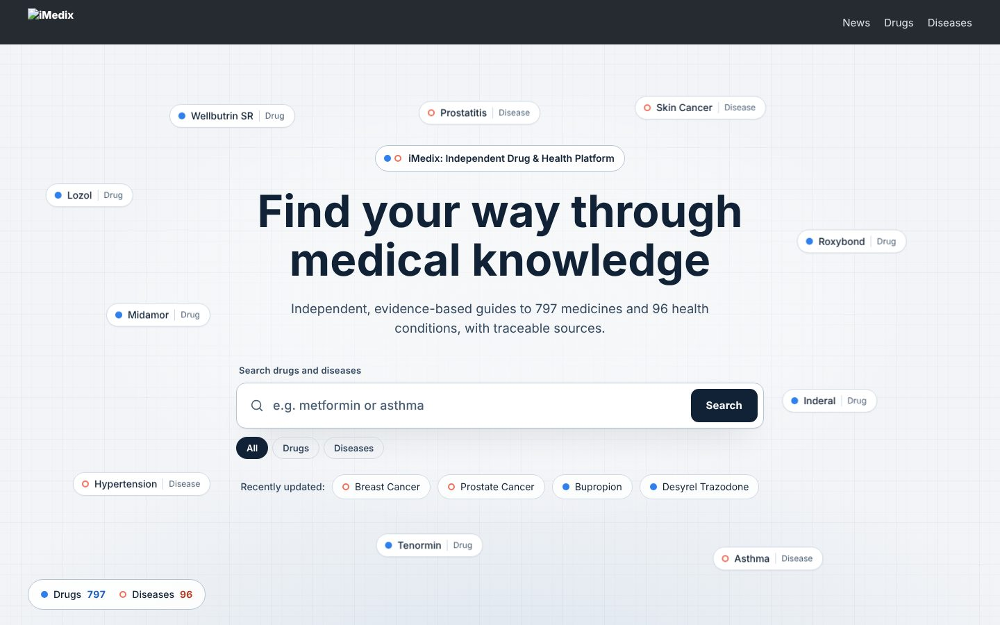
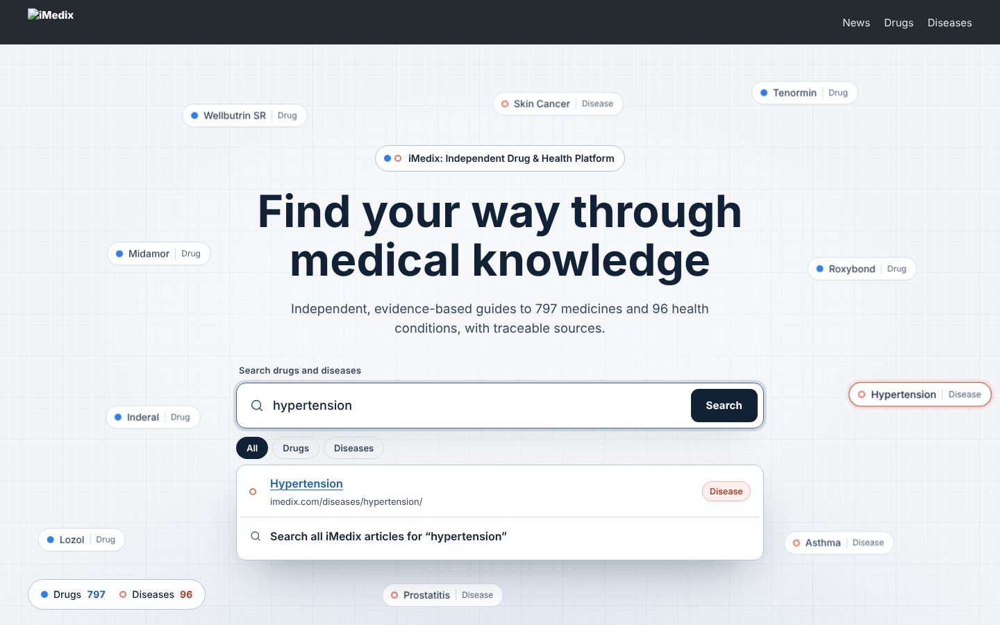
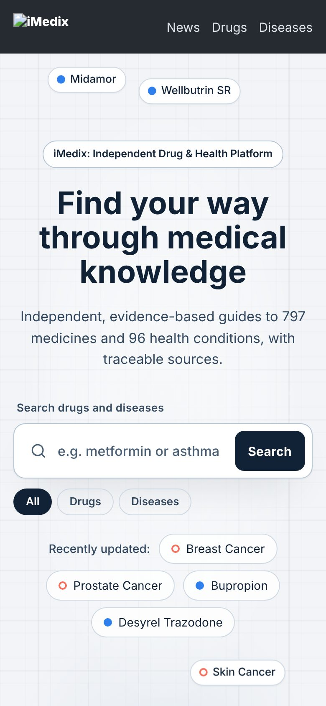
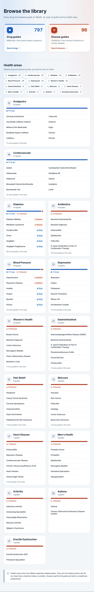

# iMedix Knowledge Universe

A homepage for **www.imedix.com** (English site) — *iMedix: Independent Drug & Health Platform*:
a central medical search framed by floating labels of real drug and disease guides on a quiet
grid, the library of guides, and a live ticker of the site's own news —
delivered as a **WordPress plugin** that provides a page template and keeps the existing theme,
header, footer and SEO setup.



| Search highlights the best match | Mobile | Library |
|---|---|---|
|  |  |  |

## What it does

* **Entities from the Google Sheet "iMedix Drug Remediation — Master Tracker"**, synced
  server-side on a schedule, filtered by `Status` / `Decision`, checked against the redirect sheet,
  and confirmed as **published in WordPress** at their canonical URLs.
* **Floating guide labels**: real drugs (dot) and diseases (ring) from the synced data, placed
  around the headline and search without ever covering them, each a link to its WordPress guide;
  slow drift (off for reduced motion), highlighted by search. No 3D renderer, no WebGL.
* **Search** that works without JavaScript (native `/?s=`), and with it: instant suggestions with
  typo tolerance and redirect aliases, keyboard and screen-reader support; the best match's label
  moves beside the search field.
* **News ticker** from the existing `news` custom post type (no new news system), cached and
  refreshed, pausable, reduced-motion aware.
* **Library** of every drug and disease guide, by type and by health area (editorial groupings,
  shown neutrally and labelled as non-clinical).
* **Honest data**: the tracker holds no clinical relationships, so none are shown or implied.

## Repository

| Path | Contents |
|---|---|
| `wordpress/imedix-knowledge-universe/` | The plugin (PHP core + WordPress layer + templates) |
| `frontend/` | TypeScript/Vite sources of the bundle |
| `bin/` | `package.sh` (release zip), `build-graph.php` (offline graph), `render-preview.php` |
| `tests/` | PHP core tests, WordPress integration, browser e2e, tracker snapshot fixtures |
| `docs/` | Documentation (below) |
| `.claude/skills/` | UI UX Pro Max skill used for the design work |

## Documentation

* [AUDIT.md](docs/AUDIT.md) — Phase 1 findings (repository, sheet, WordPress, skill)
* [ARCHITECTURE.md](docs/ARCHITECTURE.md) — stack, integration method, search, caching, security, SEO
* [DATA-PIPELINE.md](docs/DATA-PIPELINE.md) — sync, eligibility rules, graph schema, provenance
* [DESIGN.md](docs/DESIGN.md) — UI UX Pro Max research, three directions, decision
* [BRAND-ALIGNMENT.md](docs/BRAND-ALIGNMENT.md) — iMedix typography and colour alignment, tokens, before/after
* [WORDPRESS-INTEGRATION.md](docs/WORDPRESS-INTEGRATION.md) — install, configure, staging pre-flight
* [DEPLOYMENT.md](docs/DEPLOYMENT.md) — build, rollout, rollback
* [TESTING.md](docs/TESTING.md) — test suites and results

## Quick start

```bash
bin/package.sh                               # → build/imedix-knowledge-universe-<version>.zip
cd frontend && npm ci && npm run dev         # local preview of the real template (fixture data)
```

Install the zip on **staging**, run *Settings → Knowledge Universe → Sync now*, create a page with
the *iMedix Knowledge Universe* template, review, and only then switch the static front page.
Nothing deploys automatically.

---

### Кратко по-русски

Плагин WordPress для главной страницы iMedix (только английский сайт, «iMedix: Independent Drug &
Health Platform»): центральный поиск (работает и без JavaScript) на светлом фоне с едва заметной
сеткой, вокруг — плавающие подписи реальных препаратов и заболеваний из Google Sheets (с проверкой
публикации в WordPress), каждая ведёт на статью; библиотека статей и бегущая строка новостей из
существующего CPT `news`. 3D/WebGL и three.js больше не используются. Медицинских связей
«лекарство → болезнь» не выдумываем: в данных их нет. Установка и проверка — в
[WORDPRESS-INTEGRATION.md](docs/WORDPRESS-INTEGRATION.md); на прод ничего не выкатывается без
явного одобрения.
